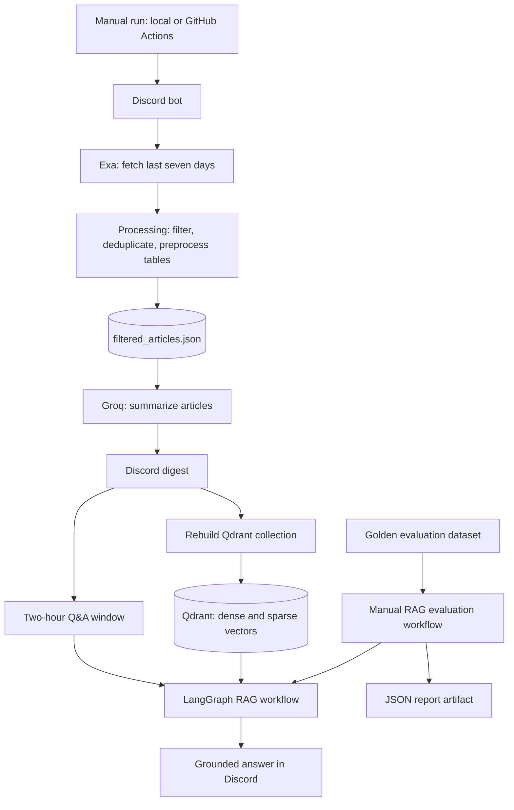

# Stack Feed

Stack Feed collects a week of AI news, filters and summarizes the articles, and
publishes a digest to Discord. After publication, it indexes the selected
articles in Qdrant and opens a two-hour question-and-answer window powered by
the RAG workflow.

## Features

- Fetches recent AI news from Exa across model releases, product and tooling,
  safety, and research.
- Removes short and duplicate articles, filters for technical relevance, and
  selects up to 12 stories for the digest.
- Converts article tables to factual prose and summarizes each selected article
  with Groq-hosted models.
- Publishes category embeds and article summaries to Discord, then opens a
  two-hour Q&A window.
- Indexes articles in Qdrant for dense and sparse hybrid retrieval.
- Routes questions by answer shape, checks for missing evidence, and generates
  answers grounded in retrieved article text.
- Runs a shared golden dataset through the RAG graph and records evaluation
  reports locally or as GitHub Actions artifacts.

## Architecture



## How It Works

1. On every bot run, `fetcher/exa_fetcher.py` searches four AI-news topics for
   articles published in the previous seven days and writes raw results to
   `articles.json`.
2. `processing/article_filter.py` checks article length, removes duplicate URLs
   and near-duplicate highlights, and uses TypeSafe to screen for technical
   relevance. It keeps the Exa-assigned category and selects up to 12 stories.
3. `processing/process_content.py` rewrites article tables as factual prose.
   `processing/summarizer.py` summarizes each selected article into concise
   bullets for Discord.
4. `discord_bot.py` posts the digest and calls `rag.vector_store.ingest_digest`
   to rebuild the `weekly_digest_structured` Qdrant collection from
   `filtered_articles.json`.
5. During the Q&A window, `rag.workflow` routes questions through category
   classification, retrieval, evidence review, and grounded generation.
6. `evals/run_suite.py` runs the golden questions through the same graph, scores
   retrieval and generation, and writes a timestamped report to
   `evals/results/`.

See the focused guides for the [article processing pipeline](processing/README.md)
and [RAG workflow](rag/README.md).

## Setup

Install Python 3.11 or newer and [uv](https://docs.astral.sh/uv/), then install
the project dependencies:

```bash
uv sync
```

Create API keys for Exa, TypeSafe, Groq, and Qdrant. For the Discord bot,
create a bot application in the Discord Developer Portal, enable the Message
Content intent, and invite it with permission to view the digest channel, send
messages, create public threads, send messages in threads, and embed links.
Enable Developer Mode in Discord to copy the digest channel ID.

Create a root `.env` file for local runs. The full bot requires:

```text
DISCORD_TOKEN=your_discord_bot_token
DIGEST_CHANNEL_ID=your_digest_channel_id
EXA_API_KEY=your_exa_api_key
TYPESAFE_API_KEY=your_typesafe_api_key
GROQ_API_KEY=your_groq_api_key
QDRANT_URL=your_qdrant_cloud_url
QDRANT_API_KEY=your_qdrant_api_key
```

`LANGSMITH_API_KEY` and `LANGSMITH_TRACING=true` enable optional LangSmith
tracing and evaluation feedback. `HF_TOKEN` is optional and may help with
authenticated Hugging Face model downloads. Keep `.env` private; do not commit
secret values.

## Run Locally

Run the Discord bot, which fetches and filters the current seven-day window,
publishes the digest, and rebuilds the Qdrant index on every run:

```bash
uv run python discord_bot.py
```

To fetch and filter articles without starting the bot:

```bash
uv run python fetcher/exa_fetcher.py
uv run python processing/article_filter.py
```

Run the RAG evaluation suite against the configured Qdrant collection:

```bash
uv run python evals/run_suite.py
```

The collection must already contain the digest chunks. The suite does not
rebuild or modify it. Evaluation reports are written to `evals/results/`, which
is ignored by Git.

## GitHub Actions

Both workflows are started manually from the repository's **Actions** tab.

- `weekly-bot.yml` runs the complete digest bot. Add repository secrets
  `DISCORD_TOKEN`, `DIGEST_CHANNEL_ID`, `EXA_API_KEY`, `TYPESAFE_API_KEY`,
  `GROQ_API_KEY`, `QDRANT_URL`, and `QDRANT_API_KEY`. `HF_TOKEN` and
  `LANGSMITH_API_KEY` are optional.
- `rag-eval.yml` runs the evaluation suite against the existing Qdrant
  collection. It needs `GROQ_API_KEY`, `QDRANT_URL`, `QDRANT_API_KEY`, and
  `TYPESAFE_API_KEY`. `LANGSMITH_API_KEY` is optional. The generated JSON report
  and log are uploaded as a 30-day workflow artifact.

## Project Structure

```text
stack-feed/
|-- .github/workflows/
|   |-- weekly-bot.yml          # Manually run the digest bot
|   |-- rag-eval.yml            # Manually run RAG evaluation
|-- discord_bot.py              # Discord digest and Q&A orchestration
|-- fetcher/
|   |-- exa_fetcher.py          # Fetch recent articles from Exa
|-- processing/
|   |-- article_filter.py       # Filter, deduplicate, and select articles
|   |-- process_content.py      # Convert tables to factual prose
|   |-- summarizer.py           # Prepare article summaries
|   |-- README.md               # Article filtering guide
|-- rag/
|   |-- chunking.py             # Split articles into section-aware chunks
|   |-- vector_store.py         # Create and ingest the Qdrant collection
|   |-- hybrid_search.py        # Dense and sparse retrieval
|   |-- category_search.py      # Retrieve broad category coverage
|   |-- retriever.py            # Routing and retrieval nodes
|   |-- generator.py            # Grounded answer generation
|   |-- workflow.py             # Assemble the LangGraph workflow
|   |-- prompts.py              # RAG prompt templates
|   |-- README.md               # RAG implementation guide
|-- evals/
|   |-- golden_dataset_router_eval.json # Shared evaluation questions
|   |-- run_suite.py            # Run graph and evaluate results
|   |-- results/                # Generated, Git-ignored reports
|-- prompts.py                 # Processing prompt templates
|-- groq_retry.py               # Shared Groq retry helper
|-- logging_setup.py            # Shared file logger setup
|-- pyproject.toml              # Project dependencies and metadata
```

**Author:** Moksh Jain

**Credits:** OpenAI, Exa, Groq, Qdrant, TypeSafe, and DeepEval

[LinkedIn](https://www.linkedin.com/in/itsmoksh/) | [GitHub](https://github.com/itsmoksh) | [Portfolio](https://codebasics.io/portfolio/Moksh-Jain)
