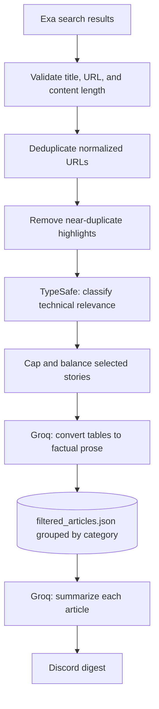

# Article Processing

The processing package turns raw Exa results into a small, technically relevant
weekly article set, prepares article content for indexing, and creates the
summaries posted in the Discord digest. The category comes from the Exa query;
the TypeSafe relevance check decides whether to keep an article, not which
category it belongs to.

## Pipeline



## Article selection

`ArticleFilter.filter_articles()` runs these steps in order:

1. **Validate:** keeps articles with a title and URL and more than 500 characters
   of content.
2. **Deduplicate URLs:** normalizes the scheme and host, removes a trailing path
   slash and URL fragment, then keeps the first occurrence. Query strings are
   retained.
3. **Deduplicate similar stories:** embeds Exa highlights with
   `sentence-transformers/all-MiniLM-L6-v2` and compares each candidate with
   previously kept highlights. If cosine similarity is at least `0.72`, the
   later article is dropped. When highlights are missing, the first 1,500
   content characters are used instead.
4. **Check technical relevance:** TypeSafe's `jev-latest` model classifies the
   title and highlights. It favors model releases, research, developer tools,
   AI safety/security, and hardware or inference benchmarks. It excludes
   business partnerships, mergers, commercial integrations, customer stories,
   marketing, executive moves, and general sales announcements. If the TypeSafe
   request fails, the current implementation keeps the article with a fallback
   confidence of `0.5`.
5. **Select the weekly set:** if more than 12 articles remain, it first selects
   one per category, then fills the remaining places by relevance confidence.
   The default caps are two safety stories and five stories per other category.
   If 12 or fewer articles remain, they are returned without this capping pass.

The fetcher assigns the categories `model release`, `product/tooling`,
`safety`, and `research` based on its four search queries. The article relevance
classifier does not relabel them.

## Table preparation and summaries

Before filtered articles are written, `save_filtered_articles()` sends Markdown
tables to Groq for a short factual prose conversion. The prompt asks the model to
preserve benchmark rows, model names, labels, values, and markers. A table
preprocessing failure raises an error and prevents the filtered JSON from being
written, so a partial processed set is not saved.

`summarizer.py` summarizes each article into three to five bullets. The root
`prompts.py` contains the article relevance, summary, and table-reformatting
prompts. Summaries are generated per article and returned grouped by category to
the Discord bot.

## Files and commands

- Root `articles.json`: raw Exa results as a list of articles.
- Root `filtered_articles.json`: selected and table-preprocessed articles,
  grouped by their existing category. Both data files are ignored by Git.
- `article_filter.py`: length, duplicate, relevance, and selection logic.
- `process_content.py`: Markdown table extraction and prose conversion.
- `summarizer.py`: load or refresh the selected articles and generate summaries.

Run the fetch and filter steps from the project root:

```bash
uv run python fetcher/exa_fetcher.py
uv run python processing/article_filter.py
```

The bot calls `summarize(refresh=True)` on each run. It fetches and filters the
current seven-day window even when `filtered_articles.json` already exists, then
overwrites that file with the fresh selected set before summarizing. The
standalone commands above let you run those fetch and filter steps separately.

Fetching needs `EXA_API_KEY`; relevance filtering needs `TYPESAFE_API_KEY` and
the Hugging Face sentence-transformer model. Table preprocessing and summaries
need `GROQ_API_KEY`.
