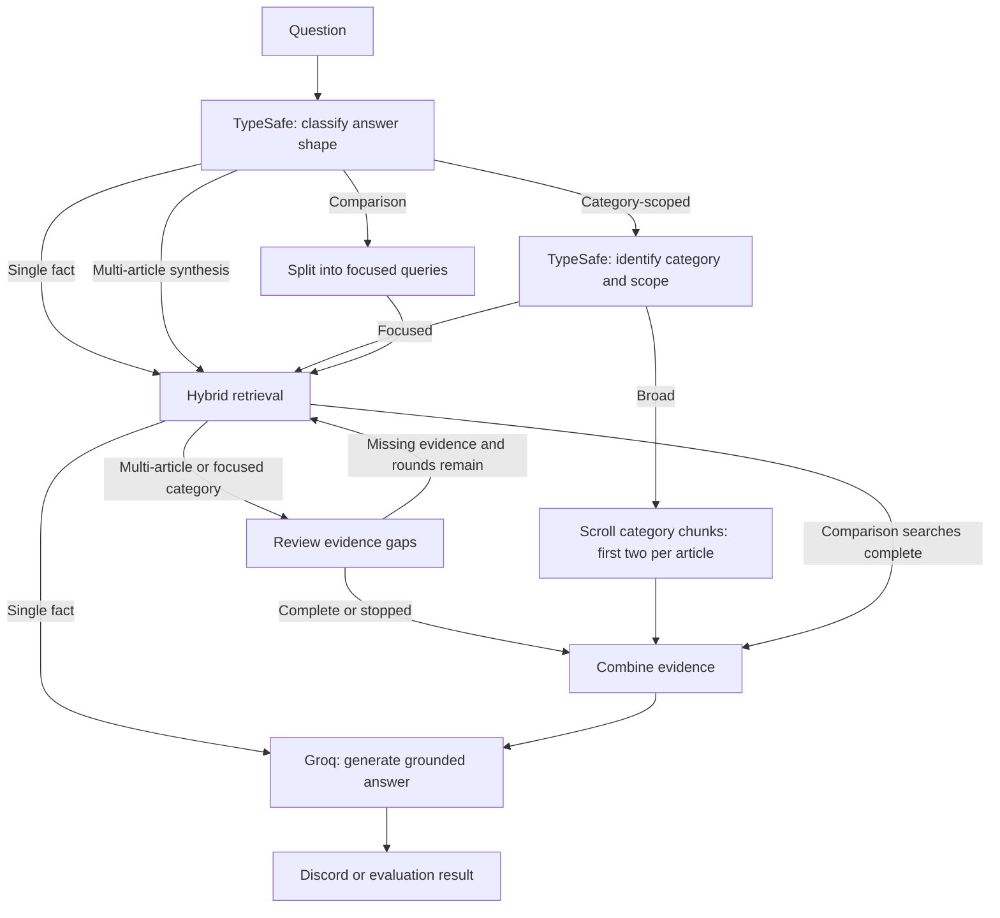

# RAG Workflow

The RAG package answers questions about the articles indexed for the latest
digest. It uses LangGraph to route questions, Qdrant for hybrid retrieval, and a
Groq-hosted chat model to write grounded answers.

## Workflow

`build_graph()` in `workflow.py` builds the graph. The Discord bot uses its
streaming generator; evaluation code uses the same graph with a regular
generator.



### Routing and retrieval

- **Single fact:** searches Qdrant with the original question.
- **Comparison:** decomposes the question into at most five focused searches,
  then combines unique results.
- **Multi-article:** searches broadly and can run up to three evidence-gap
  follow-up rounds.
- **Category-scoped:** TypeSafe selects one digest category and a `broad` or
  `focused` scope. Broad questions scroll all chunks for that category and keep
  the first two chunks per article. Focused questions use hybrid search with a
  category filter and bounded evidence-gap follow-ups.

Hybrid search uses Qdrant's dense and sparse prefetches, fused with reciprocal
rank fusion. Follow-up searches stop when there are no new chunks, the evidence
review finds enough support, or the configured round limit is reached.

The generator is instructed to use retrieved article evidence only. When no
evidence is available, it returns the configured abstention answer. Article
text is treated as source data, not as instructions.

## Qdrant collection

`vector_store.py` stores chunks in the `weekly_digest_structured` collection.
`StructureAwareChunker` splits articles on Markdown section headers, splits
large sections further, and drops near-empty fragments. It adds the article
title and category to the text used for embeddings, while storing the original
chunk text and article metadata in the payload.

The collection uses Qdrant cloud inference with the
`sentence-transformers/all-MiniLM-L6-v2` dense model and Qdrant BM25 sparse
vectors. The `category` payload is indexed for filtered search.

Calling `ingest_digest(refresh=True)` deletes and recreates this collection
before uploading chunks from the root `filtered_articles.json`. The Discord bot
does this after publishing each digest. The evaluation suite only queries the
existing collection; it does not ingest or change data.

## Run and evaluate

For a local graph call, configure `GROQ_API_KEY`, `TYPESAFE_API_KEY`,
`QDRANT_URL`, and `QDRANT_API_KEY`, then use:

```python
from rag.workflow import build_graph

graph = build_graph()
result = graph.invoke({"question": "What research papers were in this week's digest?"})
print(result["answer"])
```

The Discord bot configures streaming with `build_graph(stream_generator=True)`.
The evaluation suite can be run from the project root with:

```bash
uv run python evals/run_suite.py
```

The suite runs the golden dataset through this graph and writes a timestamped
JSON report under `evals/results/`. It can also publish per-question feedback to
LangSmith when `LANGSMITH_API_KEY` is configured.

## Module map

- `workflow.py`: LangGraph assembly and conditional routing.
- `state.py`: shared `RAGState` fields.
- `retriever.py`: TypeSafe routing, query decomposition, retrieval, evidence-gap
  review, and evidence combination.
- `hybrid_search.py`: dense and sparse Qdrant search and rank fusion.
- `category_search.py`: category scroll and per-article chunk selection.
- `chunking.py`: section-aware article chunking.
- `vector_store.py`: collection setup, ingestion, and chunk payloads.
- `generator.py`: grounded answer generation and streaming.
- `prompts.py`: routing, retrieval, and answer prompt builders.
